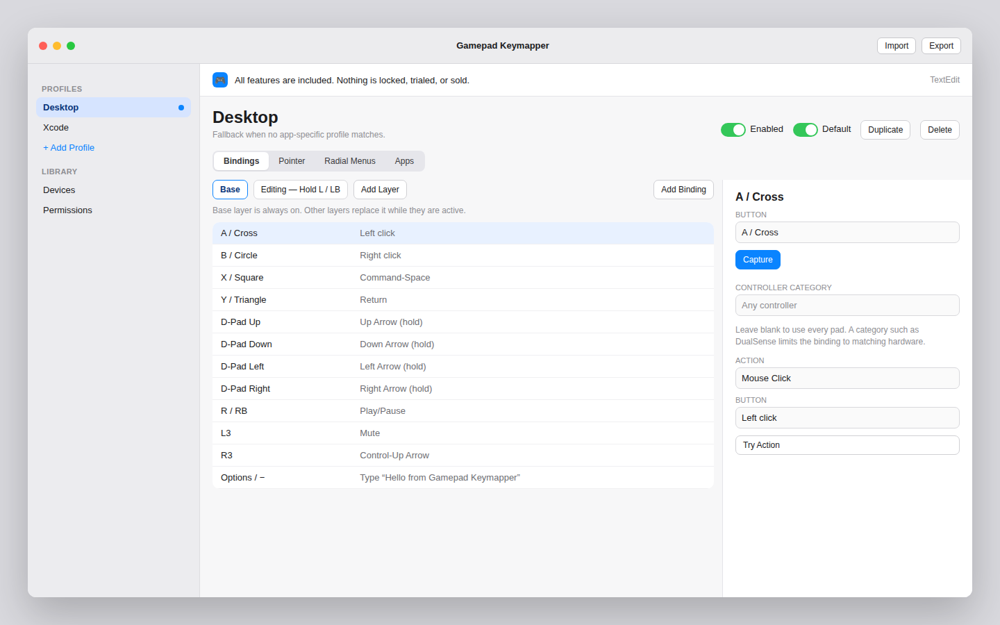
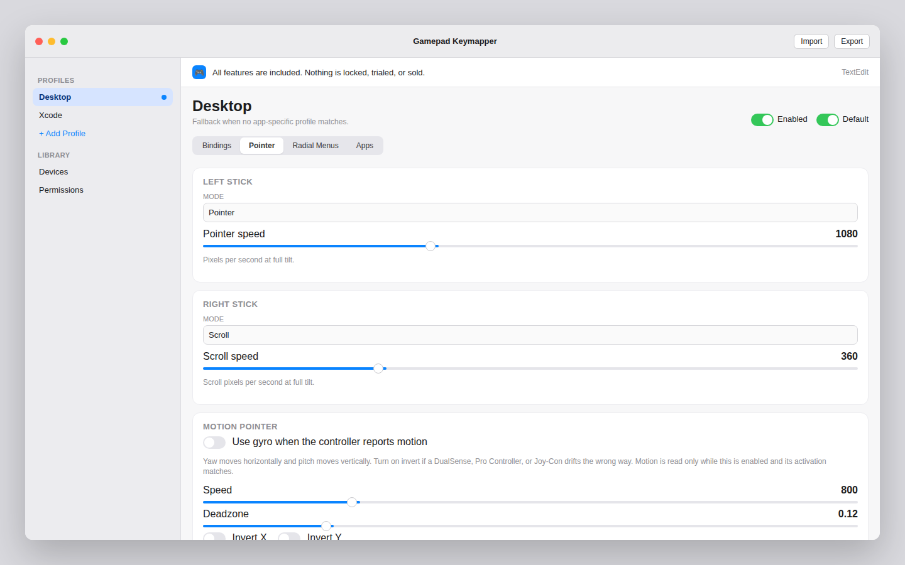
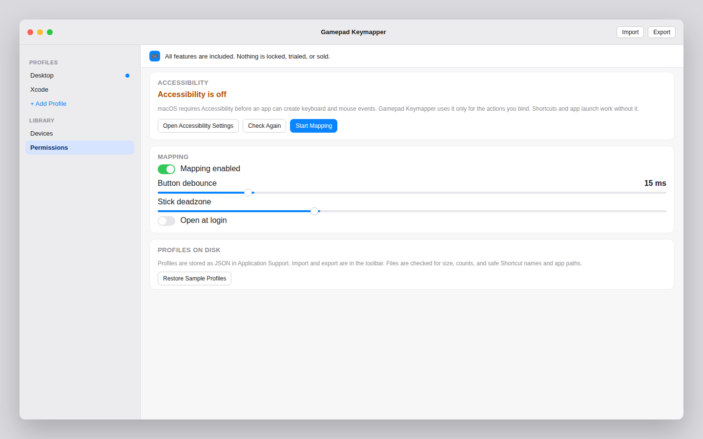

# Gamepad Keymapper


A menu-bar app for macOS 14 and later that turns a game controller into keyboard, mouse, Shortcut, and app-launch input. Every feature is included. There is no trial, no account, and nothing to buy.

Gamepad Keymapper is an independent project. It is not affiliated with ConMapper or its developer. The behavior below follows that app’s public feature description only. The code, UI, and profile format are original.



## What you can map

- Buttons to keys, chords, and media keys (play, volume, brightness). Hold a binding to keep the key down, or tap it.
- Mouse clicks, scrolling, and pointer nudges.
- Gyro pointer movement when GameController reports motion (DualSense, many Pro Controllers, and some Joy-Cons). Invert either axis. Activate always, or only while a button is held.
- Sticks as a pointer, as scroll, or as digital directions you can bind like buttons.
- A macOS Shortcut by name, through `/usr/bin/shortcuts run` (one argument, not a shell command).
- Launch or activate an app by bundle id or an absolute `.app` path.
- Text snippets.
- App profiles. A pinned profile ignores the frontmost app. Otherwise a profile is chosen only when one of the apps you added on its Apps tab is frontmost. The default profile is the fallback.
- Layers. Hold or toggle a modifier button to swap in another binding set. Unmapped buttons can fall through to the base layer. The modifier itself does not also type.
- More than one controller at the same time. Each pad keeps its own held buttons and layer toggles.
- Radial menus. Hold the trigger, aim with a stick or the D-pad, release to run the slice. B cancels. Releasing with nothing highlighted cancels.
- Import and export of profile JSON.

Joy-Con, Switch Pro, DualShock, DualSense, and Xbox pads are whatever GameController enumerates. A single Joy-Con often exposes its stick as the only direction pad; that stick is used as the left stick.

## Build and run

Requirements: macOS 14 or later, and Xcode 15 or later.

1. Open `GamepadKeymapper.xcodeproj`.
2. Select the Gamepad Keymapper scheme and run it.
3. The app is a menu-bar item (`LSUIElement`). Open **Editor** from the menu if the window does not appear.
4. On first launch, use **Open Accessibility Settings**, enable Gamepad Keymapper, then **Check Again**.

The project signs locally with an ad-hoc identity (`CODE_SIGN_IDENTITY` is `-`) so Xcode can run it without a development team. The app target compiles the core sources directly, so the app does not import a separate module.

```bash
xcodebuild -project GamepadKeymapper.xcodeproj -scheme GamepadKeymapper -destination 'platform=macOS' CODE_SIGNING_ALLOWED=NO build
```

That command needs macOS and Xcode. It cannot be run in a Linux environment. `CODE_SIGNING_ALLOWED=NO` is the CI override. A local Run from Xcode uses the ad-hoc signature. Accessibility permission is tied to that signature. An ad-hoc rebuild can change it, so macOS may ask you to grant Accessibility again.

Release builds should enable the hardened runtime and sign with a Developer ID. Local runs stay ad-hoc so the project opens without a development team.

Logic tests do not need a Mac:

```bash
swift test
bash Scripts/security-scan.sh
```

`swift test` covers profile JSON, import sanitizing, layer resolution, press/release, profile switches, two controllers, radial aiming, debounce, and stick/gyro scaling. The AppKit target itself builds only on macOS.

## Permissions

macOS requires Accessibility before a process can create keyboard and mouse events. Gamepad Keymapper uses that permission only to post the actions you configured. It does not install an event tap and it does not read what you type. The radial menu is drawn by the app and can open without Accessibility. Keys, clicks, and pointer moves cannot. The editor shows a banner, and the menu bar names the last button received, so a press that does nothing is not a missing controller.

Shortcuts and app launch work without Accessibility. Keyboard, mouse, scroll, text, and media keys do not.

The menu-bar app sets `GCController.shouldMonitorBackgroundEvents` so GameController keeps delivering input while another app is frontmost.

Profiles stay on this Mac, in:

```text
~/Library/Application Support/GamepadKeymapper/profiles.json
~/Library/Application Support/GamepadKeymapper/settings.json
```

Nothing is uploaded. The app does not open network connections.

## Sample profile

`Samples/desktop-navigation.json` is the document the app seeds on first launch. Import it from the toolbar, or use **Restore Sample Profiles** on the Permissions page.

Desktop (the fallback):

| Input | Action |
| --- | --- |
| A / B | Left / right click |
| X | Command-Space |
| Y | Return |
| D-pad | Arrow keys, held |
| R | Play/Pause |
| L3 | Mute |
| R3 | Control-Up |
| Options / − | Types “Hello from Gamepad Keymapper” |
| Menu / + | Radial menu (TextEdit, Safari, System Settings, media, Spotlight, a snippet). Aim with the D-pad. |
| Left stick | Pointer |
| Right stick | Scroll |
| ZL / LT | Gyro pointer, off until you enable it |

The sample ships Desktop only. Add apps on the Apps tab if you want a profile to follow the frontmost app. Pin a profile from the menu bar or the editor when that choice should win.






## How a press is handled

Controller callbacks are coalesced onto one queue. Stick and motion samples keep only the latest value, so a noisy gyro cannot grow a backlog. Button edges are capped. There is no timer while the app is idle.

A press commits immediately. Chatter inside the debounce window (15 ms by default) is ignored, and a timer runs only when a change arrived during that window and still needs to commit. A pointer timer runs only while a button is holding a mouse-move action. Gyro callbacks are installed only while gyro is enabled and its activation button matches, and only again when the held buttons, profile, or enabled state change. With the editor closed and nothing held, the menu-bar app does not run a repeating timer; closing the editor releases its view. A debug build with the editor open and idle stays near 70 MB and 0% CPU.

Switching profiles releases keys and mouse buttons that are still down. A button that is still physically held does not fire the new profile until you release it and press it again. Disconnecting a controller releases only that controller’s holds.

Two controllers are different sessions even when they are the same model. A binding applies to every connected pad. Each pad keeps its own held buttons and layer toggles, so one controller’s hold does not change the other.

## Security

- No StoreKit, no trial, no license check.
- No `URLSession` and no network entitlement.
- Profile files are capped at 1 MB, 40 profiles, 12 layers, 96 bindings, and 8 radial items.
- Unknown action types are rejected. Extra JSON keys are ignored and are not executed.
- Imported profiles are sanitized, then they can run Shortcuts, launch apps, and type text. Import does not ask for a second confirmation. Line breaks in typed text are replaced with spaces.
- Shortcut names are a single `shortcuts` argument. Names with control characters or a leading `-` are cleared and will not run.
- App paths must be absolute, must not contain `..`, and must be an `.app` bundle. Bundle ids must look like bundle ids.
- The only `Process` is `/usr/bin/shortcuts`. Output goes to `/dev/null`. At most four Shortcuts run at once, and each is terminated after 30 seconds.
- Key capture for the editor is a normal text field in our window. It is not a global event monitor.

`Scripts/security-scan.sh` checks those boundaries.

## QA checklist

Use this on a Mac before handing the build to someone else. `swift test` does not replace it.

**Permissions**

- [ ] First launch explains Accessibility and opens System Settings.
- [ ] Before it is granted, keys and mouse do nothing useful, and the editor says so.
- [ ] A Shortcut and an app launch still run without Accessibility.
- [ ] After granting it, a click and a key binding reach the frontmost app.
- [ ] Quit, sleep, and turning mapping off do not leave a modifier stuck.

**Buttons and layers**

- [ ] Press and release of a held key (an arrow) presses and releases that key once.
- [ ] A noisy press does not repeat the action inside the debounce window.
- [ ] Add a layer that shows while a button is held. Its bindings replace Base until you release that button. The hold button itself does not also run a Base action.
- [ ] Toggle a layer, press a face button, toggle it off, and confirm the base action is back.
- [ ] With fall-through off, an unmapped button on that layer does nothing.

**Profiles and controllers**

- [ ] With nothing pinned, Desktop stays active until another profile lists the frontmost app. Pinning a profile ignores the frontmost app until you choose Automatic.
- [ ] Opening this app’s editor does not replace the frontmost profile with a profile for Gamepad Keymapper.
- [ ] Switching apps while a click is held releases the mouse button and does not immediately click in the new profile.
- [ ] Two pads can hold different buttons at once. The same binding runs on each pad. Unplugging one releases only that pad.

**Pointer, gyro, radial**

- [ ] Left stick moves the pointer only outside the deadzone. A long pause does not fling the cursor.
- [ ] Right stick scrolls.
- [ ] With gyro enabled, the pointer moves only while ZL / LT is held. Invert fixes a backwards axis.
- [ ] If the controller does not report motion, the Devices page says so and the pointer stays still.
- [ ] Hold Menu, aim with the D-pad, release, and the highlighted item runs.
- [ ] B, or releasing with the stick centered, cancels the menu.
- [ ] While the menu is open, the aiming stick does not also scroll or move the pointer.

**Editor and security**

- [ ] Remapping does not freeze the window. The Devices list does not refresh unless that page is open.
- [ ] Import of `Samples/desktop-navigation.json` round-trips.
- [ ] A JSON file over 1 MB is rejected. An action of type `shell` is rejected.
- [ ] A Shortcut name with a newline, or an app path like `../Foo.app`, is not executed.
- [ ] There is no purchase, trial, or locked-feature UI anywhere, including the menu bar.
- [ ] With no controller input and the editor closed, the process is not spinning a timer.

## Layout

```text
Sources/GamepadKeymapperCore   profile model, resolver, JSON (tested on Linux and macOS)
App/                           SwiftUI menu-bar app, GameController, CGEvent
Samples/desktop-navigation.json
GamepadKeymapper.xcodeproj
```

`GamepadKeymapper.xcodeproj` is the project to open and build. Add new Swift files to that project when you introduce them.

## License

MIT. See [LICENSE](LICENSE).
