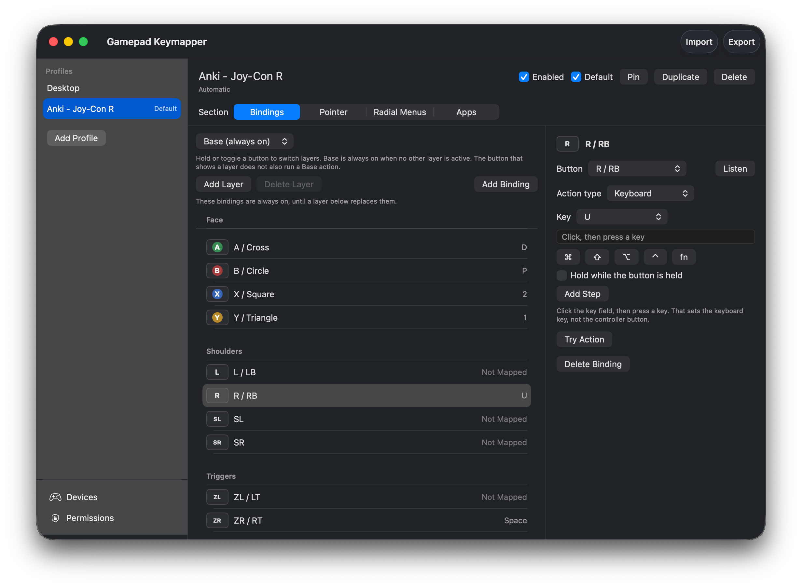
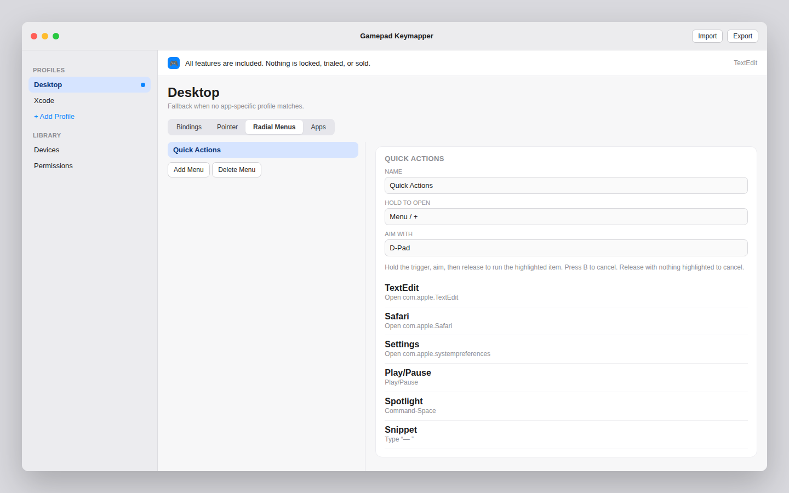

<p align="center">
  
</p>

<h1 align="center">Gamepad Keymapper</h1>

<p align="center">A menu-bar app for macOS 14 and later that turns a game controller into keyboard, mouse, Shortcut, and app-launch input.</p>

<p align="center">
  
</p>

Every feature is included. There is no trial, no account, and nothing to buy. Gamepad Keymapper is an independent project. It is not affiliated with ConMapper or its developer. The behavior follows that app’s public feature description only. The code, UI, and profile format are original.

## Features

- Buttons mapped to keys, chords, and media keys (play, volume, brightness). Hold a binding to keep the key down, or tap it.
- Mouse clicks, scrolling, and pointer nudges.
- Gyro pointer movement when GameController reports motion (DualSense, many Pro Controllers, and some Joy-Cons). Invert either axis. Activate always, or only while a button is held.
- Sticks as a pointer, as scroll, or as digital directions you can bind like buttons.
- A macOS Shortcut by name, through `/usr/bin/shortcuts run` (one argument, not a shell command).
- Launch or activate an app by bundle id or an absolute `.app` path.
- Text snippets.
- App profiles. A pinned profile ignores the frontmost app. Otherwise a profile is chosen only when one of the apps you added on its Apps tab is frontmost. The default profile is the fallback.
- Layers. Hold or toggle a modifier button to swap in another binding set. Unmapped buttons can fall through to the base layer. The modifier itself does not also type.
- More than one controller at the same time. Each pad keeps its own held buttons and layer toggles.
- Radial menus. Hold the trigger, aim with a stick or the D-pad, release to run the slice. B cancels. Releasing with nothing highlighted cancels.
- Import and export of profile JSON.

Joy-Con, Switch Pro, DualShock, DualSense, and Xbox pads are whatever GameController enumerates. A single Joy-Con often exposes its stick as the only direction pad; that stick is used as the left stick.

The app does not open network connections, does not install an event tap, and does not read what you type.

## Requirements

- macOS 14 or later
- Xcode 15 or later, to build
- A controller that GameController exposes

## Build and run

1. Open `GamepadKeymapper.xcodeproj`.
2. Select the Gamepad Keymapper scheme and run it. The project signs ad-hoc (Sign to Run Locally), so it does not need an Apple Developer team.
3. The app is a menu-bar item and does not show a Dock icon until the editor is open. Choose **Open Editor…** from the menu if the window does not appear.
4. On first launch, use **Open Accessibility Settings**, enable Gamepad Keymapper, then quit and reopen the app. Press **Check Again**.

```bash
xcodebuild -project GamepadKeymapper.xcodeproj -scheme GamepadKeymapper -destination 'platform=macOS' CODE_SIGNING_ALLOWED=NO build
```

That command needs macOS and Xcode. `CODE_SIGNING_ALLOWED=NO` is the CI override. A local Run from Xcode uses the ad-hoc signature.

To keep the Accessibility grant across rebuilds, select your team on the Gamepad Keymapper target, switch signing to Automatic, and use the Apple Development identity. An ad-hoc rebuild changes the code signature, so macOS treats it as a different app.

Release builds in this repo stay ad-hoc and do not enable the hardened runtime. For a copy you hand to someone else, sign with a Developer ID and turn the hardened runtime on.

Logic tests do not need a Mac:

```bash
swift test
bash Scripts/security-scan.sh
```

`swift test` covers profile JSON, import sanitizing, layer resolution, press and release, profile switches, two controllers, radial aiming, debounce, and stick and gyro scaling. The app target builds only on macOS.

## Permissions

**Accessibility.** macOS requires it before a process can create keyboard and mouse events. Gamepad Keymapper uses it only to post the actions you configured. The radial menu is drawn by the app and can open without it. Keys, clicks, scrolling, pointer moves, text, and media keys cannot. Shortcuts and app launch work without it. After you allow the app, quit and reopen it. macOS often ignores the new trust until the next launch. The editor shows a banner until the grant is visible, and the menu bar names the last button received, so a press that does nothing is not a missing controller.

**Input Monitoring.** A lone Joy-Con’s physical L/R and ZL/ZR are not in the GameController profile, so the app reads them from the controller’s HID report. macOS may ask for Input Monitoring before those buttons arrive. The other buttons, the sticks, and the radial menu do not need it. If the prompt was denied, the Devices page still lists the controller and the rest of the pad keeps working. SL and SR on a lone Joy-Con come from GameController and do not need that prompt.

The menu-bar app sets `GCController.shouldMonitorBackgroundEvents` so GameController keeps delivering input while another app is frontmost.

## Usage

Open the editor from the menu bar. Pick a profile, then a section: Bindings, Pointer, Radial Menus, or Apps. Choose a control and set the action, or press **Listen** and press the control on the pad. **Try Action** runs that action. Devices lists connected controllers. Permissions holds the Accessibility check, button debounce, stick deadzone, and **Open at login**.

With nothing pinned, the default profile stays active until another profile lists the frontmost app. Pin a profile from the menu bar or the editor when that choice should win. Opening this app’s editor does not replace the frontmost profile with one for Gamepad Keymapper.

`Samples/desktop-navigation.json` is what the app seeds on first launch. Import it from the toolbar, or use **Restore Sample Profiles** on the Permissions page.

| Input | Action |
| --- | --- |
| A / B | Left / right click |
| X | Command-Space |
| Y | Return |
| D-pad | Arrow keys, held |
| R | Play/Pause |
| L3 | Mute |
| R3 | Control-Up |
| Options / − | Types “Hello from Gamepad Keymapper” |
| Menu / + | Radial menu (TextEdit, Safari, System Settings, media, Spotlight, a snippet). Aim with the D-pad. |
| Left stick | Pointer |
| Right stick | Scroll |
| ZL / LT | Gyro pointer, off until you enable it |





Profiles and settings stay on this Mac:

```text
~/Library/Application Support/GamepadKeymapper/profiles.json
~/Library/Application Support/GamepadKeymapper/settings.json
```

Nothing is uploaded. Imported profiles are capped (1 MB, 40 profiles) and checked before they can run a Shortcut, launch an app, or type text.

Switching profiles releases keys and mouse buttons that are still down. A button that is still physically held does not fire the new profile until you release it and press it again. Disconnecting a controller releases only that controller’s holds. Quit, sleep, and turning mapping off do the same for every pad.

## Troubleshooting

- **A press does nothing.** Look at the menu bar. If it names the button, the controller is connected and Accessibility is blocking the event. Enable Gamepad Keymapper in Privacy & Security → Accessibility, then quit and reopen the app.
- **It worked, then a rebuild stopped sending keys.** An ad-hoc signature changes every rebuild, so the old Accessibility row no longer matches. Remove the stale row, enable the new build, quit, and reopen. A development team and Automatic signing keep the same identity across rebuilds.
- **A lone Joy-Con’s L, R, ZL, or ZR never fires.** Allow Gamepad Keymapper under Privacy & Security → Input Monitoring, then reconnect the controller. SL, SR, the face buttons, and the stick do not use that permission.
- **The pointer or gyro stays still.** On Pointer, confirm the stick mode and that gyro is enabled. The Devices page says when the controller does not report motion. Gyro in the sample profile runs only while ZL / LT is held, and only after you turn it on.
- **A key or mouse button stays down.** Quit the app, turn mapping off, or disconnect that pad. Each of those releases holds. Sleep releases them too.

## License

MIT. See [LICENSE](LICENSE).
